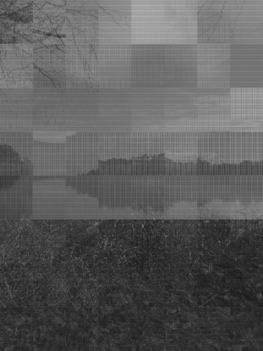
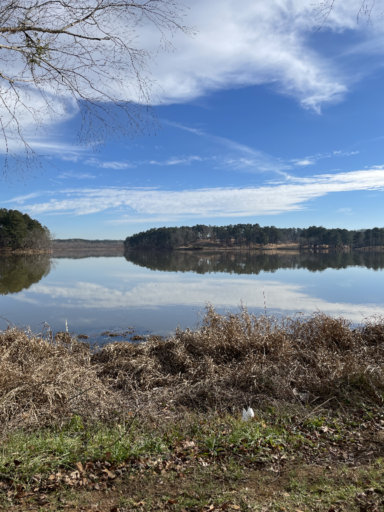

# glycin-dng

A [glycin](https://gitlab.gnome.org/GNOME/glycin) loader for Adobe DNG files.
It lets GNOME's Image Viewer (Loupe) and other glycin-based apps open DNG
photos, including iPhone ProRAW, which no current distribution supports out
of the box.

Instead of developing the raw sensor data, the loader serves the camera's own
full-resolution JPEG preview that every DNG embeds. For a viewer this is the
better trade: you see the image the way the camera rendered it, it opens in a
fraction of a second, and files whose raw compression is newer than your
decoders (ProRAW Max uses JPEG XL) still open fine, because the preview stays
plain JPEG.

| upstream glycin-raw (libopenraw 0.4.0-alpha.12) | glycin-dng |
|---|---|
|  |  |

Test photo: iPhone 12 Pro ProRAW sample from [raw.pixls.us](https://raw.pixls.us/) (CC0).

## Why this exists

- GNOME 49+ decodes images through glycin's sandboxed loaders. No
  distribution ships a RAW loader today; Ubuntu 26.04 and Fedora both skip it.
- Upstream glycin has a `glycin-raw` loader built on libopenraw, but the
  libopenraw alpha it pins mangles iPhone ProRAW (left image above).
- Standalone raw editors (darktable, RawTherapee, gThumb) can open DNG, but
  that is an extra app, not system support.

## How it works

The loader walks the DNG's TIFF structure: the IFD0 chain plus SubIFDs. Every
IFD that stores a JPEG blob becomes a candidate, either through the classic
JPEGInterchangeFormat pair or as a single JPEG-compressed strip. The primary
preview (NewSubfileType = 1) wins over other candidates, grayscale IFDs (DNG
semantic masks) rank last, and the largest blob breaks ties. The JPEG is
decoded with the `image` crate, and the DNG's Orientation tag is handed to
glycin, which applies the rotation. Around 300 lines of Rust, with the TIFF
scanner covered by unit tests.

## Installation

Build dependencies: Rust 1.92 or newer, plus the libseccomp headers
(`sudo apt install libseccomp-dev` on Debian/Ubuntu,
`sudo dnf install libseccomp-devel` on Fedora).

User install, no root needed:

    make install

This puts the loader in `~/.local/libexec` and its config in
`~/.local/share/glycin-loaders/2+/conf.d/`. glycin scans user data
directories and bind-mounts loader binaries from outside `/usr` into its
sandbox, so a home-directory install is fully supported. Restart the viewer
app afterwards.

System-wide install:

    sudo make install PREFIX=/usr

Registered MIME type: `image/x-adobe-dng`.

To open DNG files in Loupe on double click:

    xdg-mime default org.gnome.Loupe.desktop image/x-adobe-dng

### File manager thumbnails

The system install also registers a thumbnailer entry that routes DNG
thumbnails through `glycin-thumbnailer`. The user install skips that part on
purpose: GNOME runs thumbnailers inside a bwrap sandbox that only exposes
`/usr`, so a loader under `~/.local` is not reachable from there. Viewer apps
are unaffected.

## Scope and limitations

- Viewer-grade by design. It shows the camera's rendering and does not
  demosaic, so it is no substitute for a raw developer.
- A DNG without any embedded JPEG preview is rejected with an error saying
  so. In practice iPhones and mainstream cameras always embed one.
- Loading only; editing and saving through glycin are not implemented.

## Compatibility

Written and tested against glycin 2.1 (config protocol `2+`, `glycin-utils`
4.1) on Ubuntu 26.04 with GNOME 50 and Loupe. Verified with iPhone 12 Pro
ProRAW and iPhone XS DNG samples, orientation handling included.

Once libopenraw handles ProRAW correctly, distributions will hopefully ship
the official `glycin-raw`. This loader can then retire, or stay around for
the speed of preview-based viewing.

## Uninstall

    make uninstall              # or: sudo make uninstall PREFIX=/usr

## License

MPL-2.0 OR LGPL-2.1-or-later, matching glycin. See LICENSE-MPL-2.0 and
LICENSE-LGPL-2.1.

## Credits

- The [glycin](https://gitlab.gnome.org/GNOME/glycin) project; the loader
  structure follows `glycin-raw` by Hubert Figuière.
- Sample photos from [raw.pixls.us](https://raw.pixls.us/) (CC0).
